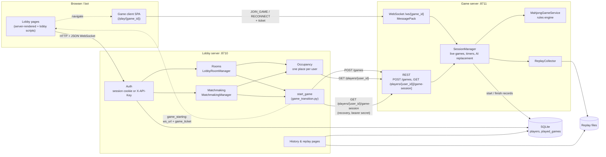
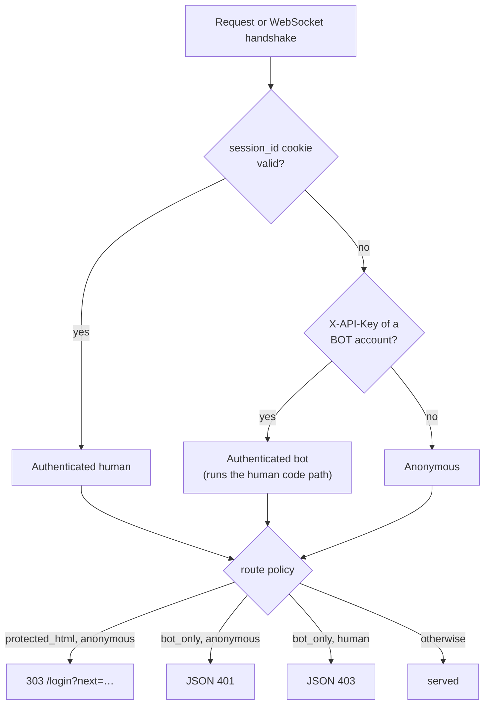
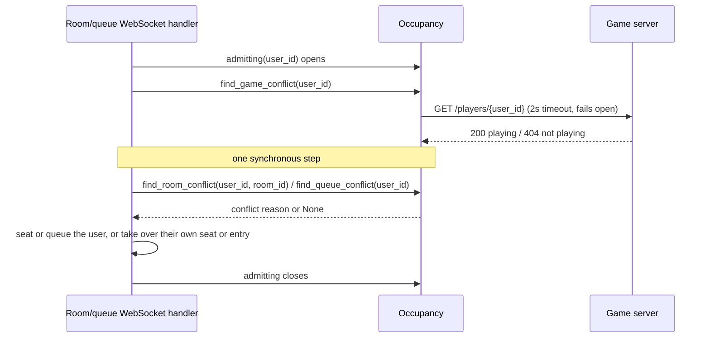
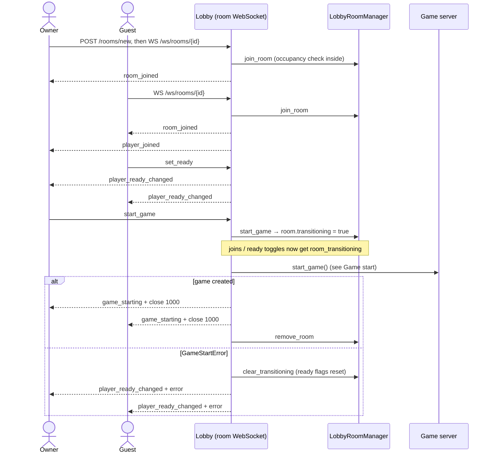
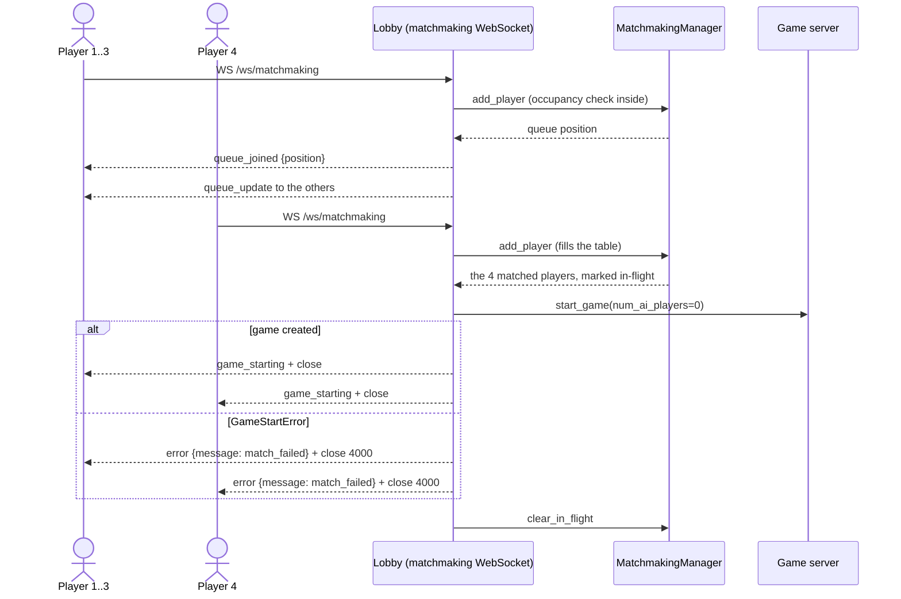
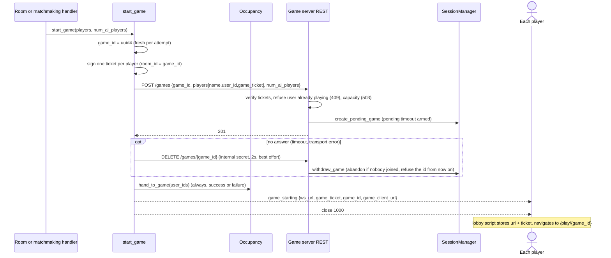
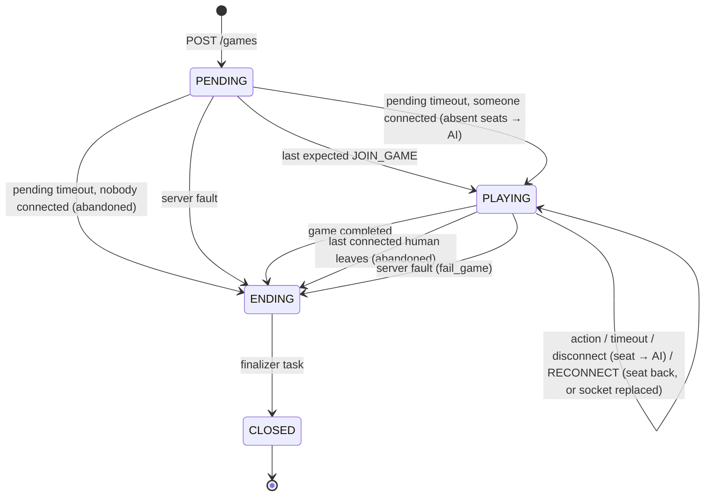
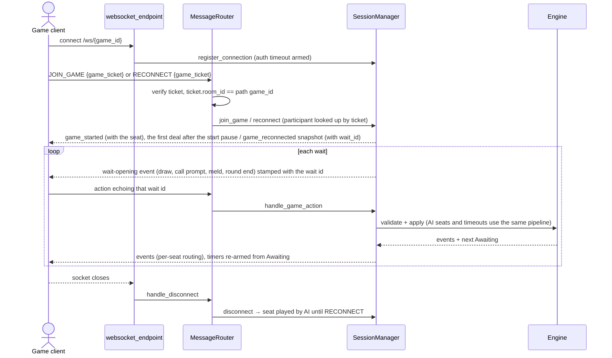

# Backend architecture

How the lobby, the game server and matchmaking fit together. The `AGENTS.md` files hold the rules
of each package; this document is the map. The code (route tables, message models, settings
classes) stays the reference for anything not drawn here.

## Components

Two Starlette processes share one SQLite database, one HMAC secret for game tickets and one
internal API secret. The lobby is the only public HTTP surface; the game server exposes REST to the
lobby only and a WebSocket to players.

Key facts the diagram cannot show:

* **Both servers are single-process asyncio.** Every state transition (seat, queue, join, action,
  disconnect) is one synchronous step on the event loop, so neither server holds a lock. Sends and
  closes only enqueue onto a per-connection writer task, so no step ever waits on a slow client.
* **No shared in-memory state between the two servers.** The lobby learns "who is playing" by
  asking the game server over REST; the game server learns who may join from the signed tickets.
* **Live games are memory only.** The session layer owns each game's `GameRuntime`; the engine is
  synchronous and stateless across games and knows nothing of sockets, accounts or time. A game
  server restart loses every live game: the SQLite records and replay files are history, not
  checkpoints.
* **SQLite is behind one worker thread per process**, and the game server's record writes are
  fire-and-forget (logged on failure).

## Authentication

* Sessions are **in-memory** on the lobby with a 24h TTL: a restart logs everyone out.
* The login redirect's `next` (only for a GET: another method's target cannot be reopened) rides
  through the login, register and guest forms, and each of them returns there after creating the
  session.
* A **guest** (`POST /guest`) gets a session like any other, with a fresh user id and a generated
  `Nanashi-NNNN` name, but no `players` row: nothing past the session reads that table.
* Every HTTP route carries exactly one policy decorator; WebSocket handlers authenticate inside
  (`Origin` check, then `websocket.user`).
* **Game tickets** are HMAC-SHA256 tokens `{user_id, username, room_id=game_id, expires_at}`
  signed by the lobby and verified by the game server. They are the only credential the game
  server knows; it never sees cookies or API keys.

## Occupancy: one place per user

A user is in at most one of: a room seat, the matchmaking queue (queued or matched), or a live game.
Rooms and matchmaking never import each other; both receive the rule as an injected callable.

The lookup can go stale: a game start may hand the user to a game while the request is in flight.
`start_game` therefore marks every open admission of its players, and both conflict checks reject
a marked one as `already_in_game` in the same synchronous step that would seat or queue.

A join to the place the user already holds (their seat in that room, or their unmatched queue
entry) is admitted and takes the place over: the new connection keeps the seat, readiness and
arrival order or the queue position, and the old connection gets `replaced_by_new_connection` and
a close. Once the place's game is being created nothing is taken over: a transitioning room refuses
the join as `room_transitioning` and a matched user gets `match_starting`; a later join finds the
game and is handed it (below). The room page retries such a join on its own after a short delay;
the matchmaking page offers a retry. The occupancy check runs first in the seating step, so a join
whose lookup overlapped its own room's start is answered `already_in_game` with the game, never
`room_not_found`.

The game server is the backstop: `POST /games` refuses a player already in one of its games with
409, and "playing" is answered only from its in-memory sessions (a disconnected participant still
counts until the game ends).

## Recovering a lost handoff

The ticket is signed once and delivered once, in `game_starting`, and the game client keeps it only
in its tab's `sessionStorage`. A player whose lobby socket closed during the start, who closed the
game tab, or whom the game client sent to the lobby (a 1008 kick, exhausted retries) holds a seat
but no ticket, and occupancy keeps them out of everything else until the game ends. Recovery hands
back the participant's own ticket, the same string the game server keys the seat by, so nothing is
re-signed or rotated:

* The game server's `GET /players/{user_id}/game-session` returns the user's game id and exact
  ticket. It answers only the internal API secret as a bearer token (the game server's CORS lets
  the lobby origin read its GETs in development, so network isolation alone is not enough), never
  through Traefik, and every credential-bearing answer is `Cache-Control: no-store`.
* The lobby asks it only for the authenticated user (`find_game_handoff`), never for a client-given
  id, and adds the `ws_url` and `game_client_url` a start would send. A lookup failure is an error,
  not "not playing": unlike the occupancy lookup it never fails open.
* Two entry points: a room or matchmaking join refused as `already_in_game` is answered with
  `game_starting` (both lobby pages already follow it; the room page of a room removed by its
  game's start redirects a playing user to that game's page), and the game page, finding no
  handoff in its tab, fetches `GET /api/game-session` (a same-origin JSON route under the login), stores the
  answer like the lobby does and plays on; a different live game sends it to that game's page.
* The client then joins as after any start: JOIN_GAME while pending, RECONNECT after
  `join_game_already_started` once the game plays (it may start between the lookup and the join),
  taking the seat over from any socket still holding it. A game that ended meanwhile refuses the
  join and the client returns to the lobby.

## Rooms

A room is a pre-game table of 4 fixed seats. Every seat starts with a tsumogiri bot; a joining human
takes the first bot seat and a leaver hands the exact seat back. The first joiner owns the room and
is the only one who can start it.

Nothing starts automatically, and a room that nobody starts expires and closes its sockets. Ready,
ownership and rate-limit rules are in `backend/lobby/rooms/AGENTS.md`.

## Matchmaking

A FIFO queue with no client messages: the socket's only signal is its disconnect.

* The join that completes the match resolves it, inside that player's handler; the other three are
  only written to.
* A failed creation is terminal: nobody is requeued, because the game may exist on the game server
  anyway (until withdrawn, below).
* A matched player who disconnects before the game starts keeps the seat; the game server gives a
  no-show seat to AI.

## Game start (shared by rooms and matchmaking)

`start_game` in `lobby/game_transition.py` is the one handoff.

A failure before the 201 raises `GameStartError` and the caller recovers (room reopens, match
fails). A fresh id per attempt means a timed-out request that did create the game leaves an orphan
instead of colliding with a retry. The orphan would hold its players as playing until its pending
timeout (a room's retry refused as `player_in_game`, a matchmaking rejoin handed into the orphan),
so a failure that got no answer withdraws the id first: the game server abandons the game if it
exists and nobody joined it, and refuses a creation under that id that arrives later. A failed
withdrawal leaves the orphan to its pending timeout.

## Game server: a game's life

The end is claimed once, synchronously, for every reason: the claim sets ENDING, drops the game and
its tickets from the registry (so the lobby's "playing" answer flips at once) and hands the effects
to one finalizer task. The finalizer saves the replay (unless abandoned), posts the finish record
(only for a game that recorded a start) and closes the sockets, then sets CLOSED. Abandoned means no
human connection remains, not that a player is at fault.

A graceful stop (SIGTERM) runs no drain of its own: it goes through the normal disconnect path.
uvicorn first closes every socket with 1012, delivering each handler its disconnect, and waits for
the handlers up to `--timeout-graceful-shutdown`; each handler's own `finally` runs
`handle_disconnect`. Timers and AI play keep running in that window. A playing game hands each
leaving seat to an AI player and is abandoned at its last leave (no replay), unless AI play
completes it first; a pending game only unbinds. On this normal path every disconnect is handled
before the lifespan shutdown runs `SessionManager.shutdown()`, so only the pending games remain:
it cancels the sleeping timers still registered, awaits every finalizer, and leaves the pending
games unrecorded, since they never started. Past the timeout, uvicorn cancels the handlers still
running and starts the lifespan shutdown without waiting for them, so their disconnects (and any
abandonment they cause) can land after `shutdown()` has begun; that ordering is not guaranteed.

Per connection:

* A participant is keyed by its ticket for the whole game and its seat never rotates, so a reconnect
  with the same ticket resumes the same seat and timer bank.
* A JOIN_GAME or RECONNECT for a participant whose socket the server still holds (half-open after a
  network switch, or another tab) replaces that socket at once: the old one closes with 4002
  `replaced_by_new_connection`, after which its client stops reconnecting, or two tabs would take
  the seat from each other forever. The wait carries on with its timer; the new socket gets the
  snapshot and the event that opened the seat's wait. A 1008 kick is terminal for the client too;
  a 1000 `game_ended` close is not, so a client that missed the game end reconnects and is refused
  into the lobby.
* An action for any wait but the current one is refused as stale and touches nothing.
* Liveness is uvicorn's WebSocket ping; the apps run no heartbeat of their own. Rate limits, decode
  strikes and the auth timeout are in `backend/game/AGENTS.md`.

## Persistence

| Store | Written by | Read by |
|---|---|---|
| `players` (SQLite) | Lobby: register, bot registration script | Lobby auth |
| `played_games` (SQLite) | Game server: start record at engine start, finish record from the end finalizer | Lobby history page |
| Replay files | Game server finalizer, completed and failed games (abandoned ones are discarded) | Lobby `/api/replays/{game_id}` and `/play/history/{game_id}`; game server's internal Tenhou export, behind the lobby's `/api/replays/{game_id}/tenhou.xml` |

A replay file holds the game's recorded events plus replay-only annotation lines the replay loader
skips: each seat's replacement with an AI player (left, or absent at the first deal, recorded ahead
of that deal) and its human's return. A seat the game started with an AI player in has none.

The finish record is built from the start record, never from end-of-game connection state, so a
seat that never connected keeps its name and `user_id`. A crash leaves `ended_at` NULL, which is why
"playing" is never derived from this table.

## Game client contract

The game client (`frontend/game/`) is a separate app the lobby hosts on its own origin; any app that
honours this contract can replace it.

* **Hosting:** the lobby answers the game client's pages with the app's built `index.html`
  (`LOBBY_GAME_CLIENT_DIR`) and serves that directory under `/game-assets/`, so the app builds with
  that base path; the app routes the path itself. The pages are an explicit list in the lobby's
  route table, each with its login policy (`/play/{game_id}` requires a login; the replay
  `/play/history/{game_id}` and the storybook pages do not); any other path is a 404, so a new client
  route needs its path added there.
* **Handoff:** before navigating to `{game_client_url}/{game_id}`, the lobby page writes
  `sessionStorage.setItem("game_session:{game_id}", JSON.stringify({wsUrl, gameTicket}))`. Session
  storage is per origin, which is why the game client must be served by the lobby. A game page
  whose tab holds no entry recovers it from `GET /api/game-session` (`game_id`, `ws_url`,
  `game_ticket`, `game_client_url`; 404 when the player plays no game, 503 when the lookup failed)
  and stores it under the same key.
* **Game server:** the client joins `wsUrl` with the ticket and speaks the MessagePack protocol
  (`backend/game/messaging/AGENTS.md`); it reuses the same ticket to reconnect.
* **Closes:** the client reconnects after any close but two terminal ones, after which it stops
  reconnecting and cancels any scheduled retry: 4002 `replaced_by_new_connection` (another socket
  of the seat took it over) and 1008 `invalid_game_action` (the seat was kicked). A 1000
  `game_ended` close keeps reconnecting, so a client that missed the game end is refused into the
  lobby.
* **Replays:** `GET /api/replays/{game_id}` returns a replay's content, no login required;
  `GET /api/replays/{game_id}/tenhou.xml` downloads the same game as a tenhou.net XML log. The lobby
  cannot import the engine's converter, so it asks the game server, which converts the stored
  replay and answers only the internal API secret: 404 when no replay is stored, 422 for a failed
  game's replay (no game end, so no Tenhou log), 502 when the conversion or the call failed. The
  client's replay page renders it on the board and refuses a file whose version line is not the
  `REPLAY_VERSION` it was built for. The page's query names what it shows,
  `/play/history/{game_id}?seat=&round=&step=`, all zero-based whole numbers: `seat` the seat at the
  bottom of the table (default: the recorded first dealer's), `round` the recorded deal (repeats
  counted), `step` the position in that round (0 its deal; the final standings are the last round's
  last step). A link opens there. A bad `seat` falls back to the default, a missing or bad `round`
  to round 0's deal (its `step` ignored), a bad `step` to its round's deal. The page then keeps the
  query on the position shown with `history.replaceState`, so the address bar is the share link and
  Back leaves the replay. The lobby history page links a participant to a replay from their own
  seat, but its copy-link button copies the link without `seat`, so a shared link imposes no
  viewpoint. The game client's final standings link the player to the replay from their seat too;
  the game end reaches the players before the server has saved the replay, so the replay may answer
  404 for a moment after it.
* **Leaving:** the client returns players to the lobby at `/`.
* **Language:** the page's language is the `lang` cookie (`ja`, `en` or `ru`; `Path=/`,
  `Max-Age=31536000`, `SameSite=Lax`, `Secure` over HTTPS, not HttpOnly), which the lobby's
  `POST /lang` writes; when it is absent or holds anything else, the first supported
  `navigator.languages` entry by its primary subtag, else `en`. A replacement client honours the
  cookie, and a language choice it offers writes the same cookie with the same attributes, so the
  lobby follows it (`docs/i18n.md`). The game server sends codes, never text to show: errors carry
  a code beside an English diagnostic message the client does not display.
* **CSP:** game pages allow scripts and styles from `'self'` (inline styles too), Google Fonts, and
  WebSocket connections to any host; no `eval`, so a library that compiles code at runtime must
  run without it. A client needing more changes `SecurityHeadersMiddleware` in the lobby.

## Local run

`make run-local-server` starts the game server (`:8711`), the lobby (`:8710`) and a Vite dev server
per frontend app: the lobby's (`:5173`) and the game client's (`:5174`, proxied by the lobby).
In production Traefik fronts both services from one `docker-compose.yml`; the lobby's internal game
server URL and the public WebSocket origin it hands players are two separate settings.
