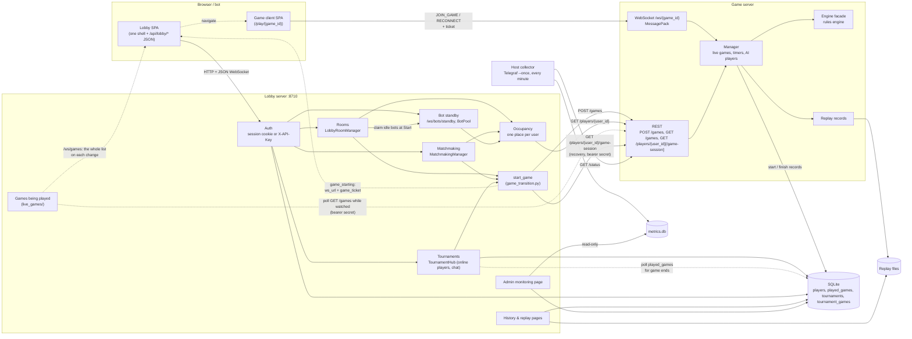
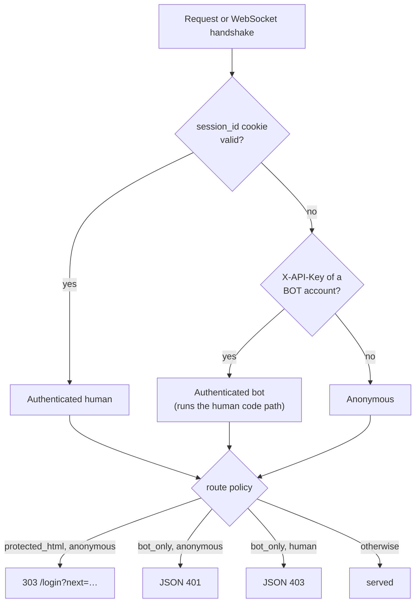
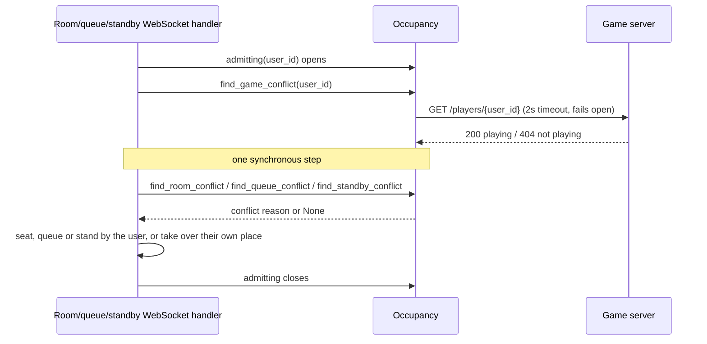
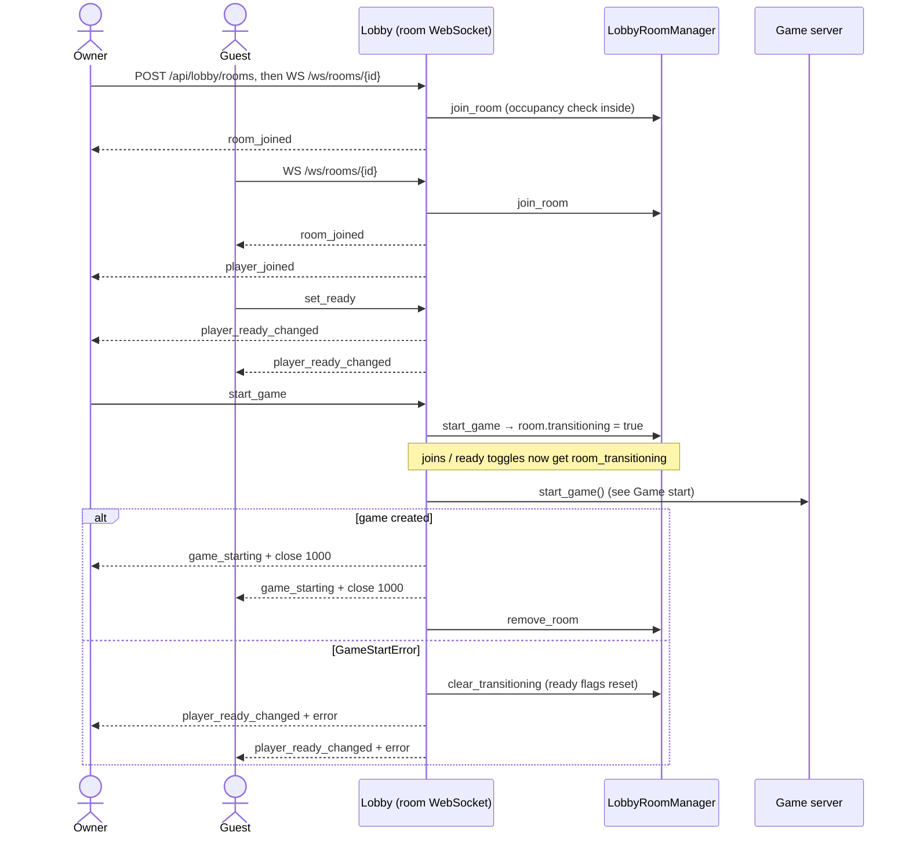
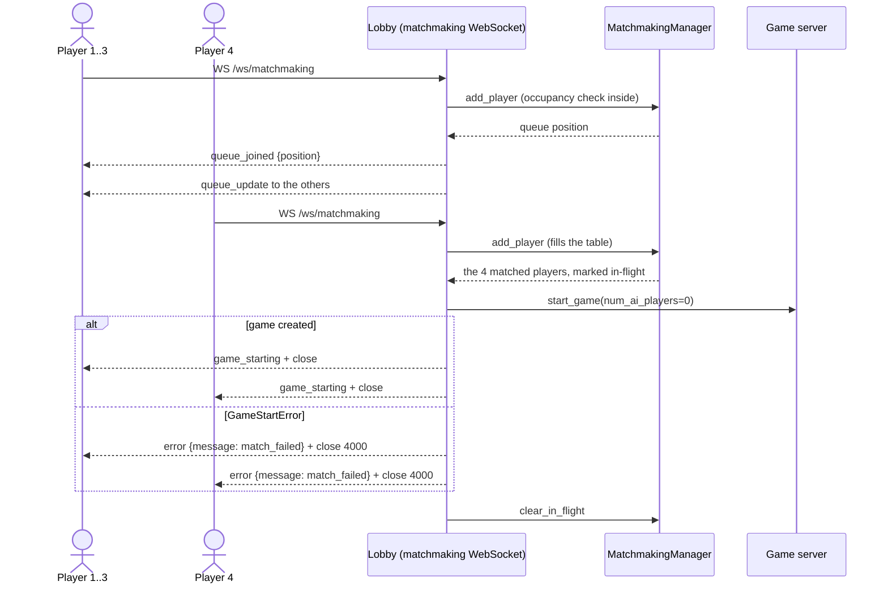
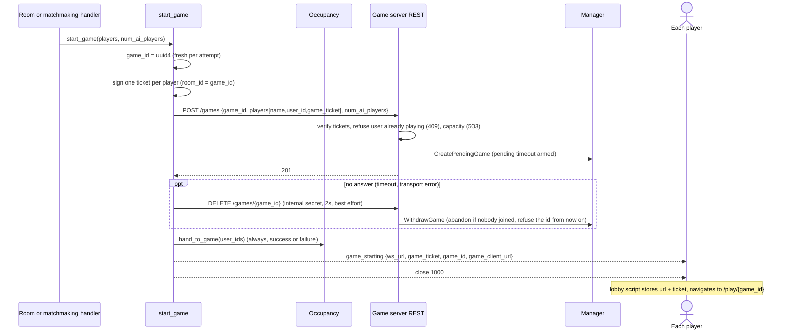
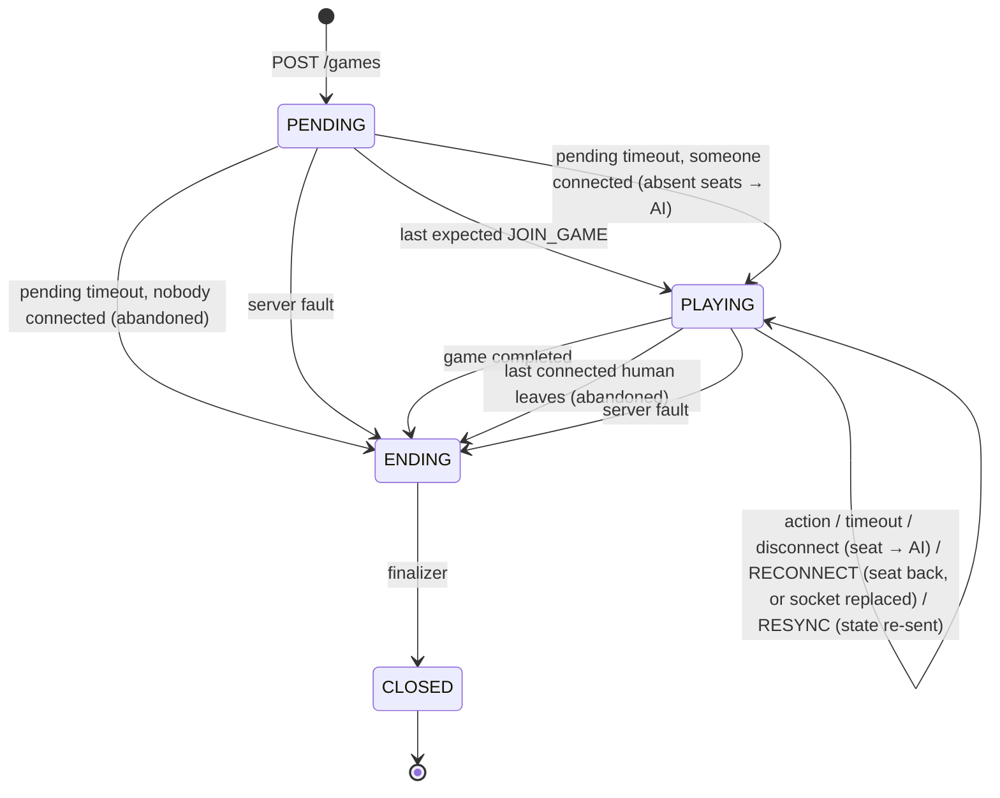

# Backend architecture

How the lobby, the game server and matchmaking fit together. The `AGENTS.md` files hold the rules
of each package; this document is the map. The code (route tables, message models, settings
classes) stays the reference for anything not drawn here.

## Components

The Python/Starlette lobby and the Go game server share one SQLite database, one HMAC secret for
game tickets and one internal API secret. The lobby is the only public HTTP surface; the game server exposes REST to the
lobby only and a WebSocket to players.



Key facts the diagram cannot show:

* **The lobby is a single-page app behind one shell.** Every lobby page route answers the same Jinja
  shell (meta tags for the CSRF token, version and dev mode, under the route's own login policy);
  the lobby app (`frontend/lobby/`) draws the page from `/api/lobby/*` JSON and navigates in place
  between its routes. Terms, privacy and error pages stay server-rendered (an error page keeps its
  HTTP status but leaves its words to the app, by code). The app's lit chrome (nav, footer,
  language switch, logout form) is on every page, and a language change never reloads or
  navigates. The lobby app and the game client build separately; the code both need (the router,
  the i18n runtime, the locale and its cookie, the session handoff, the player settings) is
  TypeScript source in `frontend/shared/` that each bundles.

* **Each server serialises its state transitions.** The lobby is single-process asyncio: every
  transition (seat, queue, join, action, disconnect) is one synchronous step on the event loop, so it
  holds no lock. The game server gives each game one goroutine, and sockets, timers, lobby calls and AI
  answers reach it only as steps on its channel, so game state takes no lock. Neither server waits on a
  slow client: sends and closes only enqueue onto a per-connection writer.
* **No shared in-memory state between the two servers.** The lobby learns "who is playing" by
  asking the game server over REST; the game server learns who may join from the signed tickets.
* **Live games are memory only.** The session layer owns each game's goroutine and state; the engine is
  synchronous and stateless across games and knows nothing of sockets, accounts or time. A game
  server restart loses every live game: the SQLite records and replay files are history, not
  checkpoints.
* **The engine sits behind one seam.** Everything else in the game server, the replay tools and the
  scripts reaches the rules engine only through the `engine/` facade (`backend/game_v2/AGENTS.md`,
  The seam). The engine owns rules, calculations and state transitions for the ruleset each game is set up with
  (Tenhou, the default, or RRC) and never learns who
  answers a seat. The session owns who plays each seat (participant, AI player or timeout), decision ids,
  timers and both pauses, the seed, seating and roster, and what a refusal leads to; messaging builds the
  prompts from a seat's decision and the reconnect snapshot from its view, and with the wire layer owns
  the integer codes, packed melds, score units, error events and the replay's rules envelope.
* **The lobby's SQLite is behind one worker thread**, and the game server's record writes are
  logged on failure (the finish row is retried).
* **Monitoring is a host-side collector, not a service.** A systemd timer runs Telegraf once a
  minute into its own SQLite file, `metrics.db` (host, cgroup slices, the game server's `/status`,
  Traefik's loopback metrics, file sizes); the lobby's admin page opens it read-only on request and
  reduces it in SQL. Nothing else reads or writes it (`deploy/AGENTS.md`, Metrics collector).

## Authentication



* Sessions are **SQLite rows** holding the SHA-256 hash of the cookie token: they survive a lobby
  restart, and a database leak yields no usable cookie. A session expires after 30 idle days for an
  account or 7 for a guest, and 90 days after login at the latest.
* The login redirect's `next` (only for a GET: another method's target cannot be reopened) rides
  through the login, register and guest views (`/api/lobby/auth/*`), and each of them returns there
  after creating the session.
* A **guest** (`POST /api/lobby/auth/guest`) gets a session like any other, with a fresh user id and a generated
  `Nanashi-NNNN` name, but no `players` row: nothing past the session reads that table.
* Every HTTP route carries exactly one policy decorator; WebSocket handlers authenticate inside
  (`Origin` check, then `websocket.user`). A logout, a session a login replaces and a rotated API key
  close the open lobby sockets that credential admitted (4001 `credential_revoked`).
* **Game tickets** are HMAC-SHA256 tokens `{user_id, username, room_id=game_id, expires_at}`
  signed by the lobby and verified by the game server. They are the only credential the game
  server knows; it never sees cookies or API keys.

## Occupancy: one place per user

A user is in at most one of: a room seat, the matchmaking queue (queued or matched), the bot standby
pool (idle or claimed, bot accounts only), or a live game. Rooms, matchmaking and the standby socket never
import each other; each receives the rule as an injected callable.



The lookup can go stale: a game start may hand the user to a game while the request is in flight.
`start_game` therefore marks every open admission of its players, and every conflict check rejects
a marked one as `already_in_game` in the same synchronous step that would seat, queue or stand by.

A join to the place the user already holds (their seat in that room, their unmatched queue
entry, or their idle standby entry) is admitted and takes the place over: the new connection keeps the seat, readiness and
arrival order or the queue position, and the old connection gets `replaced_by_new_connection` and
a close. Once the place's game is being created nothing is taken over: a transitioning room refuses
the join as `room_transitioning` and a matched user or a claimed bot gets `match_starting`, from every
socket; a standing-by bot's room or queue join is refused as `already_in_standby`. A later join finds the
game and is handed it (below). The room page retries such a join on its own after a short delay;
the matchmaking page offers a retry. The occupancy check runs first in the seating step, so a join
whose lookup overlapped its own room's start is answered `already_in_game` with the game, never
`room_not_found`.

The game server is the backstop: `POST /games` refuses a player already in one of its games with
409, and "playing" is answered only from its in-memory sessions (a disconnected participant still
counts until the game ends).

## Recovering a lost handoff

The ticket is signed once and delivered once, in `game_starting`, and the game client keeps it only
in its tab's `sessionStorage`. A player whose lobby socket closed during the start, who closed the
game tab, or whom the game client sent to the lobby (a 1008 kick, exhausted retries) holds a seat
but no ticket, and occupancy keeps them out of everything else until the game ends. Recovery hands
back the participant's own ticket, the same string the game server keys the seat by, so nothing is
re-signed or rotated:

* The game server's `GET /players/{user_id}/game-session` returns the user's game id, exact
  ticket and the seat's current `seat_version` (Seat claims below). It answers only the internal API secret as a bearer token (the game server's CORS lets
  the lobby origin read its GETs in development, so network isolation alone is not enough), never
  through Traefik, and every credential-bearing answer is `Cache-Control: no-store`.
* The lobby asks it only for the authenticated user (`find_game_handoff`), never for a client-given
  id, and adds the `ws_url` and `game_client_url` a start would send (a start's own `game_starting`
  carries `seat_version` 0). A lookup failure is an error,
  not "not playing": unlike the occupancy lookup it never fails open.
* Two entry points: a room, matchmaking or bot standby join refused as `already_in_game` is answered
  with `game_starting` (both lobby pages and the standby bot already follow it; the room page of a room removed by its
  game's start redirects a playing user to that game's page), and the game page, finding no
  handoff in its tab, fetches `GET /api/game-session` (a same-origin JSON route under the login), stores the
  answer like the lobby does and plays on; a different live game sends it to that game's page.
* The client then joins as after any start: JOIN_GAME while pending, RECONNECT after
  `join_game_already_started` once the game plays (it may start between the lookup and the join),
  taking the seat over from any socket still holding it. A game that ended meanwhile refuses the
  join and the client returns to the lobby.
* Seat claims: every handoff a client stores is a new claim, a random `claim_id` made with the
  `seat_version` the lobby read, and the client sends both unchanged in every JOIN_GAME and RECONNECT of
  that handoff. The game server binds a claim that already owns the seat, or one that names the
  seat's current version, which makes it the owner and raises the version; any other claim is closed
  with 4002 without touching the seat. So a deliberate entry (a lobby page's Return, a start, an
  `already_in_game` hand-back, a game page opened with no handoff) takes the seat over for good, and an
  older tab or device whose retry arrives later is fenced off instead of taking it back. Reading the
  version (opening a lobby page) changes nothing. A JOIN_GAME or RECONNECT with neither field, a bot's,
  binds as before only while no claim owns the seat, so an old client cannot take a claimed seat back. Two
  tabs sharing one stored claim (a duplicated tab copies session storage) are one claim to the server.

## Rooms

A room is a pre-game table of 4 fixed seats. Every seat starts with a tsumogiri bot; a joining human
takes the first bot seat and a leaver hands the exact seat back. The first joiner owns the room and
is the only one who can start it.



The owner's `start_game` may carry `strong_bots`, the number of open seats the owner marked for a bot
on the room page; that many idle standby bots (see Bot standby), at most one per open seat, are claimed
at Start, and a seat left over stays a tsumogiri bot.

Nothing starts automatically, and a room stays open while anyone is seated in it. A lost socket
holds its seat for a while, and the room page reconnects to take it back. Ready, ownership,
seat-hold and rate-limit rules are in `backend/lobby/app/rooms/AGENTS.md`.

## Matchmaking

A FIFO queue with no client messages: the socket's only signal is its disconnect.



* The join that completes the match resolves it, inside that player's handler; the other three are
  only written to.
* A failed creation is terminal: nobody is requeued, because the game may exist on the game server
  anyway (until withdrawn, below).
* A matched player who disconnects before the game starts keeps the seat; the game server gives a
  no-show seat to AI.

## Bot standby

`/ws/bots/standby` is a bot-only lobby socket: an account that is not a bot (a human's API token
passes the key check) gets `error {message: bot_account_required}` and a 4000 close. An admitted bot
is answered `standby_joined` and waits idle in `BotPool`, in memory only, sending nothing; its frames
are discarded.

* A room's start claims idle bots at random for its open seats. A claimed bot leaves idle for good and
  stays in flight until that start settles, refused everywhere as `match_starting` meanwhile, so a
  second socket of the same account cannot re-enter idle during the game server call.
* A join refused as `already_in_game` whose live game the lobby finds is handed that game
  (Recovering a lost handoff): `game_starting` and a 1000 close, never `standby_joined`. Any other
  refused join, like a non-bot account, gets an `error` frame and a 4000 close.
* Once admitted (`standby_joined`), a standby socket is sent nothing but `game_starting` and its close,
  or `replaced_by_new_connection` and a 4000 close when a newer connection of the account takes its
  entry over. A bot claimed for a start that fails gets only the 1000 close, which the bot treats as a
  retryable lobby close. Room errors never reach it: the bot ends its wait on any `error`. uvicorn's
  pings keep an idle socket alive.

## Tournaments

A tournament is a stored row; the users online on its page are only in memory. The page holds a
JSON socket, `/ws/tournaments/{id}`, through the same prologue as rooms and matchmaking
(`Origin`, auth). The lobby's `TournamentHub` keeps one connection per user per tournament: a
newer one replaces the older, which is told `replaced_by_new_connection` and closed. A join is
acknowledged with the online names, and every join or leave sends the rest the new list
(`presence`); the page words those changes as system chat lines. Chat goes to everyone online,
the sender included, with its server time in epoch seconds. The hub keeps, in memory and lost on a
restart, the last day (at most 1000 entries) of what the page shows from server events: chat, games
started and ended, and a player coming online or going offline, decided on the server as the page
words `presence` (a replaced connection or a game's players changes nothing). Each entry is the
event's own fields plus its time, never translated text. Every join gets them, oldest first, as
`history` before `joined`, without the joiner's own coming online and going offline.
The tournament socket is outside the occupancy rule: being online holds no place.

An external manager starts the games over a JSON API that only the tournament's owner can call,
authenticated by the owner's API token (`X-API-Key`, never a cookie, so its POSTs need no CSRF; anyone
else, like an unknown tournament, gets a 404). One request names up to 40 tables of four usernames,
seated East to North in list order (`start_game` with `fixed_seats`). The tables start one after
another in request order and each fails alone, with its own result: a name not online on the page,
a player the game server reports playing (the same lookup room and matchmaking joins make), or the
game start's own reason. A started table's players leave the online list at once, so a later table
naming one of them finds them offline; the game is recorded in `tournament_games` and the page is
sent `game_started` and the new `presence`. `GET /api/tournaments/{id}` is the owner's snapshot:
the online names and the recorded games.

The game server never calls the lobby about a game's end. A lobby background task polls the
`played_games` record of each unfinished tournament game every few seconds; once the game server's
finish row has `ended_at`, the lobby copies the end reason and standings into `tournament_games`
and, only when that update finished the row, sends `game_ended` to the page and the owner's events
sockets (`/ws/tournaments/{id}/events`, key-authenticated, `presence` first). A game with no finish
row stays unfinished. A player leaving a tournament game returns to the tournament page through the
game client's exit route (Game client contract). The owner may finish a tournament: its row
gains `finished_at`, its sockets are told `tournament_finished` and closed, no socket or game
start is accepted after it, and its page shows only the game history, which the page's config
answer carries. Running games play on and the poller still records their ends. The manager's side
of all this is `docs/tournament-api.md`.

## Game start (shared by rooms, matchmaking and tournaments)

`start_game` in `backend/lobby/app/game_transition.py` is the one handoff.



A failure before the 201 raises `GameStartError` and the caller recovers (room reopens, match
fails). A fresh id per attempt means a timed-out request that did create the game leaves an orphan
instead of colliding with a retry. The orphan would hold its players as playing until its pending
timeout (a room's retry refused as `player_in_game`, a matchmaking rejoin handed into the orphan),
so a failure that got no answer withdraws the id first: the game server abandons the game if it
exists and nobody joined it, and refuses a creation under that id that arrives later. A failed
withdrawal leaves the orphan to its pending timeout.

## Game server: a game's life



The end is claimed once, synchronously, for every reason: the claim sets ENDING, drops the game and
its tickets from the registry (so the lobby's "playing" answer flips at once) and hands the effects
to the game's finalizer. The finalizer saves the replay (unless abandoned), posts the finish record
(only for a game that recorded a start) and closes the sockets, then sets CLOSED. Abandoned means no
human connection remains, not that a player is at fault.

From the moment it plays, a game keeps an observer timeline beside its replay records: each record
the replay collects, stamped with the game clock when it was collected, the game start's copy
without the seed. An observer gets only the records stamped at least the observe delay ago (5
minutes by default, `Config.ObserveDelay`), so the timeline never shows the table a move younger
than that and never shows the seed, which derives every wall, future rounds' included. The end
claim seals the timeline with the end's time, for every reason; the timeline outlives the release
for the delay plus one minute, so an observer follows the game to its end, and then expires. It
lives in memory only: a restart drops it. The game server serves it on the internal route
`GET /games/{game_id}/observe?from=N`, which answers only the internal API secret: the listed game,
the wait until its first records may be seen, the records old enough from cursor `N` with each
one's stamp, the delay's cutoff, the cursor after them and whether the stream has ended, as one
MessagePack map (404 for an unknown, not yet started or expired game).

A graceful stop (SIGTERM) runs inside compose's 15 s grace period, on one deadline: the HTTP server
stops taking connections, `Server.Shutdown` closes every socket with 1012 and waits until each ran its
disconnect, then `Manager.Shutdown` drains the finalizers and the store writes, and the database
closes last. Timers and AI play keep running while the sockets drain. A playing game hands each
leaving seat to an AI player and is abandoned at its last leave (no replay), unless AI play
completes it first; a pending game only unbinds. A game still registered after the disconnects
vanishes with no finish row, which for a pending game is right, since it never started. Past the
deadline the sockets still open are dropped and the store's context is cancelled.

Per connection:

```mermaid
sequenceDiagram
    actor P as Game client
    participant WS as Server socket
    participant R as Router
    participant SM as Manager
    participant E as Engine

    P->>WS: connect /ws/{game_id}
    WS->>SM: Connect (auth timeout armed)
    P->>R: JOIN_GAME or RECONNECT {game_ticket, seat_version, claim_id}
    R->>R: verify ticket, ticket.room_id == path game_id
    R->>SM: Join / Reconnect (participant looked up by ticket)
    SM-->>P: game_joined, then once every player joined game_started (with the seat) and the first deal, which opens the start confirm / game_reconnected snapshot (with the participant's latest decision id)
    loop each wait
        SM-->>P: wait-opening event (first deal, draw, call prompt, turn, round end) stamped with the participant's decision id
        P->>R: action echoing that decision id
        R->>SM: Act
        SM->>E: act (AI players' answers and timeouts use the same call)
        E-->>SM: events; the session then reads the next Awaiting
        SM-->>P: events (per-seat routing), timers re-armed from Awaiting
    end
    P-->>WS: socket closes
    WS->>SM: Disconnect → seat played by AI until RECONNECT
```

* A participant is keyed by its ticket for the whole game and its seat never rotates, so a reconnect
  with the same ticket resumes the same seat and timer bank.
* A JOIN_GAME or RECONNECT for a participant whose socket the server still holds (half-open after a
  network switch, or another tab) replaces that socket at once: the old one closes with 4002
  `replaced_by_new_connection`, after which its client stops reconnecting, or two tabs would take
  the seat from each other forever. A new socket whose seat claim is stale (Recovering a lost handoff,
  Seat claims) is itself closed with 4002 and the held socket stays. The wait carries on with its timer; the new socket gets the
  snapshot and the event that opened the seat's wait. A 1008 kick is terminal for the client too;
  a 1000 `game_ended` close is not, so a client that missed the game end reconnects and is refused
  into the lobby.
* An action for any wait but the current one is refused as stale and touches nothing.
* The game start waits for its players: the engine stops after every deal and every round end without
  awaiting anyone, and the session holds the pause. The participants connected at the first deal owe the
  start's confirm, each one's copy of the deal opens it, and the session lets the dealer draw once every
  owing seat sent CONFIRM_ROUND or `TimerConfig.game_start_confirm_seconds` ran out and confirmed for the
  rest. A seat without a connection at the start owes none, and one that leaves during it drops out of
  the pause; both are AI players'. A zero timeout skips the confirm.
* The session plays the AI players; the engine never learns which seats they hold. After each engine
  call the session asks for one awaited AI seat's answer at a time, calls in ascending seat order and a
  turn after `TimerConfig.ai_turn_delay_seconds`, so a human can follow AI turns one at a time. The
  answer comes off the game's goroutine, from the Go server's pluggable agent (by default the
  decision's default action), and plays as one `act`; one that fails, misses the base turn time or is
  not offered plays the default instead. A human who reconnects during that delay or while its seat's
  answer is pending gets the turn back as their own decision, with no engine call. The replay runner and the fixture generators answer
  each seat themselves.
* Liveness is the game server's own WebSocket ping (20 s interval, 20 s timeout). Rate limits, decode
  strikes and the auth timeout are in `backend/game_v2/AGENTS.md`.

## Persistence

| Store | Written by | Read by |
|---|---|---|
| `players` (SQLite) | Lobby: register, bot registration script | Lobby auth |
| `tournaments`, `tournament_games` (SQLite) | Lobby: tournament creation, each started tournament game | Lobby tournament pages and API |
| `played_games` (SQLite) | Game server: start record at engine start, finish record from the end finalizer | Lobby history page |
| `metrics.db` (SQLite, its own file) | Host collector (`ronin-metrics.timer`), one sample per minute; 90 days, Traefik 30 | Lobby admin monitoring page, read-only |
| Replay files | Game server finalizer, completed and failed games (abandoned ones are discarded) | Lobby `/api/replays/{game_id}` and `/play/history/{game_id}`; game server's internal Tenhou export, behind the lobby's `/api/replays/{game_id}/tenhou.xml` |

A replay file holds the game's recorded events plus replay-only annotation records the replay loader
skips: each seat's replacement with an AI player (left, or absent at the game's start, recorded after
the first deal and ahead of the dealer's first draw) and its human's return. A seat the game started with an AI player in has none.

Storage concatenates independent MessagePack records, then compresses the stream once with gzip
level 9 and a zero timestamp. Files use `.msgpack.gz`, atomic replacement and owner-only permissions.
The storage version fixes the integer metadata-key mapping and the seed's 96-byte binary form;
decoders preserve numeric keys and restore the hexadecimal seed. Score-map seats remain data keys, the rules
envelope's keys remain strings, and lists remain arrays. Replay storage and live WebSocket encoding have separate contracts over shared fixed field IDs.

The game-start record stores the rules envelope of the game's ruleset: its profile ID (2 for Tenhou, 3 for RRC)
with no overrides, from which the replay loader picks the ruleset to play the game again under. Replays rewritten from storage version `0.4-dev` by `cmd/migrate` name profile 1: they stay
readable but no longer reproduce, so the Go replay loader and `cmd/verify` refuse them. Storage version,
RNG version and profile ID are independent.
Browser playback needs no engine or profile table: it reads recorded events and the explicit game
length, riichi-stick value and aka-dora flag. A damaged record reports its position while preserving
the readable prefix; a valid stream without a game end remains distinguishable from damaged input.

The finish record is built from the start record, never from end-of-game connection state, so a
seat that never connected keeps its name and `user_id`. A crash leaves `ended_at` NULL until the game
server starts again and ends every such row as `error`, which is why "playing" is never derived from
this table and why only one game server may write a database.

## Game client contract

The game client (`frontend/game_v2/`) is a separate app the lobby hosts on its own origin; any app that
honours this contract can replace it.

* **Hosting:** the lobby answers the game client's pages with the app's built `index.html`
  (`LOBBY_GAME_CLIENT_V2_DIR`) and serves that directory under `/game-assets/v2/`, so the app builds with
  that base path; the app routes the path itself. The pages are an explicit list in the lobby's
  route table, each with its login policy (`/play/{game_id}` requires a login; the replay
  `/play/history/{game_id}`, the observe page `/play/observe/{game_id}` and the storybook pages do not); any
  other path is a 404, so a new client
  route needs its path added there.
* **Handoff:** before navigating to `{game_client_url}/{game_id}`, the lobby page writes
  `sessionStorage.setItem("game_session:{game_id}", JSON.stringify({wsUrl, gameTicket, seatVersion, claimId}))`,
  a new `claimId` for every handoff (`claimGameSession`). Session
  storage is per origin, which is why the game client must be served by the lobby. A game page
  whose tab holds no entry recovers it from `GET /api/game-session` (`game_id`, `ws_url`,
  `game_ticket`, `seat_version`, `game_client_url`; 404 when the player plays no game, 503 when the lookup failed)
  and stores it under the same key. The v2 client forgets it at the game end, since its ticket will never
  hold the seat again, and the lobby forgets every entry of the tab on logout and before any sign-in, so a
  ticket never seats the next account to use that tab.
* **Game server:** the client joins `wsUrl` with the ticket and its seat claim (`SEAT_VERSION`,
  `CLAIM_ID`) and speaks the MessagePack protocol (`backend/game_v2/AGENTS.md`, The wire); it reuses
  the same ticket and claim to reconnect. Both directions use
  integer metadata keys from the named `WireKey` registry. Builders, serializers and schemas reference
  those keys directly; codecs validate and preserve them. Parsed models, handlers and UI keep readable fields.
  Score-map seats remain string data keys. Backend, browser and external bot codecs share golden frames
  and must be updated together; replay field IDs retain their assignments. A client that lost
  step with the messages may send RESYNC on its open socket for the reconnect's snapshot and re-sent
  wait, keeping the seat; closing to reconnect would hand the seat to an AI for the gap.
* **Closes:** the client reconnects after any close but two terminal ones, after which it stops
  reconnecting and cancels any scheduled retry: 4002 `replaced_by_new_connection` (another socket
  of the seat took it over) and 1008 `invalid_game_action` (the seat was kicked). A 1000
  `game_ended` close keeps reconnecting, so a client that missed the game end is refused on the
  reconnect. After a terminal close or a refusal, the client forgets the handoff and stays on the page, saying why, with a way back to the lobby and,
  where it may help, a reload (which recovers the handoff afresh).
* **Exit:** a live game's way back to the lobby goes to `GET /games/{game_id}/exit`, which the lobby
  redirects to the tournament page when the game is a tournament's and to the lobby otherwise. It
  decides by the game id and the stored rows alone, so it holds after a reload on the end screen,
  once the handoff is gone. The router fallback and the unsupported-browser notice name no game and
  go to the lobby.
* **Replays:** `GET /api/replays/{game_id}` returns `application/msgpack` with `Content-Encoding: gzip`,
  no login required, cached `immutable`. The client asks for `?v=<REPLAY_VERSION>`, which the lobby
  ignores, so a client built for a new replay version misses the cache once. The browser fetches binary content and decodes it inside the lazy replay route;
  `GET /api/replays/{game_id}/tenhou.xml` downloads the same game as a tenhou.net XML log. The lobby
  cannot import the engine's converter, so it asks the game server, which converts the stored
  replay and answers only the internal API secret: 404 when no replay is stored, 422 for a failed
  game's replay (no game end, so no Tenhou log), 502 when the conversion or the call failed. The
  client's replay page renders it on the board and refuses a file whose version record is not the
  `REPLAY_VERSION` it was built for. The page's query names what it shows,
  `/play/history/{game_id}?seat=&round=&step=`, all zero-based whole numbers: `seat` the seat at the
  bottom of the table (default: the recorded first dealer's), `round` the recorded deal (repeats
  counted), `step` the position in that round (0 its deal; the game's end is the last round's
  last step). A link opens there. A bad `seat` falls back to the default, a missing or bad `round`
  to round 0's deal (its `step` ignored), a bad `step` to its round's deal. The lobby redirects a link
  without `seat` to the reader's own seat when a logged-in player of that game opens it; anyone else
  gets the default. The page then keeps the
  query on the position shown with `history.replaceState`, so the address bar is the share link and
  Back leaves the replay. The lobby history page links a participant to a replay from their own
  seat, but its copy-link button copies the link without `seat`, so a shared link imposes no
  viewpoint. The game client's game end links the player to the replay from their seat too;
  the game end reaches the players before the server has saved the replay, so the replay may answer
  404 for a moment after it.
* **Observing:** `GET /api/observe/{game_id}?from=N` is a live game's delayed observer stream, no login
  required, `Cache-Control: no-store`. The lobby answers 404 for an invalid id and 400 for a `from` that
  is not one to nine ASCII digits (default 0), forwards them to the game server's internal observe route with the internal API
  secret and passes its answer through unchanged: one MessagePack map with string keys, `started_at` (Unix
  milliseconds), `game_type`, `players` (four names, East to North), `available_in_ms` (the wait until the
  first records may be seen, 0 once passed), `next` (the cursor after the returned records), `ended` (the
  stream is complete: nothing follows), `records`, the records from cursor `N` as
  concatenated MessagePack bytes in the replay encoding, without the seed (`docs/replay-format.md`),
  `stamps` (one per returned record, the version record excepted, in their order: when the game server
  collected it, in milliseconds since `started_at`) and `cutoff_ms` (the delay's cutoff in milliseconds
  since `started_at`, negative before the start is that old; no returned record is stamped after it). 404
  means the game server observes no such game: it never started, or it ended longer ago than the delay
  plus a minute. 503 means the game server could not be asked; the
  client polls again. The observe page `/play/observe/{game_id}` plays that stream in the replay viewer:
  one request at a time, the next 2 s after each answer or failure, from the `next` the last answer gave,
  until `ended` or a 404. Until the first playable record it shows the players and the time left; then it
  opens the board with autoplay on and grows the replay in place, its hands open or hidden by the reader's
  saved setting as in a replay. Autoplay keeps the table's own pace: the first answer ties its `cutoff_ms`
  to the page's clock, and each stop plays once its move's stamp is that far behind, plus one poll and its
  jitter; a result page shows at least 4 s once its panel has faded in. The page never writes its address. A 404 before the board opens says the
  game can no longer be watched; a 404 later keeps the board and stops asking. Both link the game's replay at `/play/history/{game_id}`.
* **Leaving:** the client returns players to the lobby at `/`.
* **Language:** v2 speaks Japanese, English and Russian under the lobby's contract (`docs/i18n.md`),
  with catalogs of its own. It resolves the language at page load: the `lang` cookie first, then the
  first supported entry of `navigator.languages`, then English. Its settings menu switches the
  language in place on the play and replay pages and writes the `lang` cookie on that explicit choice
  only, so the lobby follows it.
  The game server sends codes, never text to show: errors carry a code beside an English diagnostic
  message the client does not display.
* **CSP:** game pages allow scripts, styles and fonts from `'self'` (inline styles too) and WebSocket
  connections to any host; no `eval`, so a
  library that compiles code at runtime must run without it. A client needing more changes
  `SecurityHeadersMiddleware` in the lobby. The CSP goes by path, so a lobby error page answered
  on a game path (a 404 under `/play/` or `/game-assets/`, the 502/503 when the game client is
  unavailable, any 500) gets the game tier. Lobby pages use system fonts on every path; the game
  client self-hosts its font. Neither loads fonts from a third-party service.

## Local run

`make run-local-server` starts the Go game server (`:8712`, built from `backend/game_v2`), the lobby
(`:8710`, pointed at it) and a Vite dev server per frontend app: the lobby's (`:5173`) and the game
client's (`:5175`, proxied by the lobby).
In production Traefik fronts both services from one `docker-compose.yml`; the lobby's internal game
server URL and the public WebSocket origin it hands players are two separate settings.
